 

Ingénieur fraîchement diplômé de l'ISEN, avec un double diplôme à l'UQAC (Québec) spécialisé en développement de jeux vidéo. J'ai passé un an en alternance chez Betclic, dans l'équipe Contrôle Interne, à écrire de l'outillage Python et des intégrations d'API (Jira, Confluence, Microsoft Graph).

Ce qui me plaît vraiment, c'est construire des applis mobiles qu'on utilise au quotidien. La plupart de mes projets perso sont en Flutter avec Firebase, et j'ai aussi un peu de Kotlin natif sous le coude.

Je cherche un poste de développeur mobile en **PACA**, de préférence à **Toulon**, ou à **Nantes**.

**MOBILE** 

**LANGAGES & BACK** 

**OUTILS** 

| Projet | En deux mots | Techno |
|---|---|---|
| [amor_app](https://github.com/mpaitier/amor_app) | Journal de souvenirs partagé pour les couples (photos, lieux, GIF, dates), synchronisé en temps réel | Flutter · Firebase |
| [cartodex](https://github.com/mpaitier/cartodex) | Suivi de collection Pokémon TCG Pocket multi-comptes, boosters prioritaires par set | Flutter · Bloc · Clean Architecture |
| [ThirstyQuest](https://github.com/mpaitier/ThirstyQuest) | Appli sociale de suivi des boissons | Kotlin · Android |
| [quarter-bells](https://github.com/mpaitier/quarter-bells) | Jeu coopératif en ligne pour 2 à 4 joueurs, sans communication | TypeScript |

